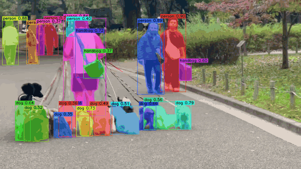

# ros_onnx_segmentation

ROS 2 node for YOLOv8 / YOLO11 instance segmentation, written in C++ on top of ONNX Runtime.
No Python or PyTorch is needed at runtime. ONNX Runtime is downloaded during the build by the `onnxruntime_vendor` package.

Tested on ROS 2 Humble (Ubuntu 22.04, OpenCV 4.5).



yolo11s-seg, 960x540 input, CPU only. Video: [Shibuya Crossing, Tokyo](https://commons.wikimedia.org/wiki/File:Shibuya_Crossing,_Tokyo,_Japan_(video).webm) by Basile Morin, [CC BY-SA 4.0](https://creativecommons.org/licenses/by-sa/4.0/). The GIF is released under the same license.

## Performance

Time from publishing a 960x540 image to receiving the overlay image, averaged over 120 frames.
Ryzen 9 5950X, `num_threads: 4`, no GPU.

| Model | Latency |
|---|---|
| yolov8n-seg | 74 ms |
| yolo11n-seg | 84 ms |
| yolo11s-seg | 172 ms |

## Packages

| Package | Description |
|---|---|
| `ros_onnx_segmentation` | Segmentation node |
| `seg_msgs` | `ObjectInfo`, `ObjectInfoArray` messages |
| `onnxruntime_vendor` | Fetches ONNX Runtime 1.17.0 (CPU) |

## Build

```bash
cd ~/ros2_ws/src
git clone https://github.com/Leeseunghun03/ros_onnx_segmentation.git
cd ~/ros2_ws
rosdep install --from-paths src --ignore-src -y
colcon build
source install/setup.bash
```

## Model

Models are not included in this repository. Export any Ultralytics segmentation model to ONNX:

```bash
pip install ultralytics
yolo export model=yolov8n-seg.pt format=onnx imgsz=640
```

Either copy the file to `ros_onnx_segmentation/models/yolov8n-seg.onnx` before building, or pass the path at launch time.
Class names are read from the model metadata, so `class_names` only needs to be set for models exported by other tools.

Ultralytics models are licensed under AGPL-3.0. Check their terms before redistributing a trained model.

## Run

```bash
ros2 launch ros_onnx_segmentation segmentation_launch.py model_path:=/path/to/model.onnx
```

Use a custom parameter file with `params_file:=/path/to/params.yaml`. See [config/params.yaml](ros_onnx_segmentation/config/params.yaml) for defaults.

### Topics

| Topic | Type | Description |
|---|---|---|
| `image_topic` (sub) | `sensor_msgs/Image` | Input image, any encoding cv_bridge can convert to BGR8 |
| `object_info_array` (pub) | `seg_msgs/ObjectInfoArray` | Bounding boxes grouped by class, in input image pixels |
| `image_debug_topic` (pub) | `sensor_msgs/Image` | Mask overlay, only when `debug` is true |

Output messages keep the header of the input image.

### Parameters

| Name | Default | Description |
|---|---|---|
| `onnx_model_path` | | Path to the `.onnx` file |
| `image_topic` | `camera/image_raw` | Input topic |
| `image_debug_topic` | `image_debug_raw` | Overlay output topic |
| `image_processing` | `letterbox` | `letterbox` or `resize` |
| `tensor_width`, `tensor_height` | `640` | Used only if the model has a dynamic input shape |
| `num_threads` | `1` | ONNX Runtime intra-op threads |
| `conf_thresh` | `0.35` | Minimum class score |
| `iou_thresh` | `0.6` | NMS, applied per class |
| `mask_thresh` | `0.3` | Mask probability cutoff |
| `class_names` | from model | Overrides the names in the model |
| `debug` | `false` | Publish the overlay image |

## License

MIT. `onnxruntime_vendor` and the node structure come from [ms-iot/ros_msft_onnx](https://github.com/ms-iot/ros_msft_onnx) (MIT, Microsoft).

## References

- https://github.com/ms-iot/ros_msft_onnx
- https://github.com/winxos/yolov8_segment_onnx_in_cpp
